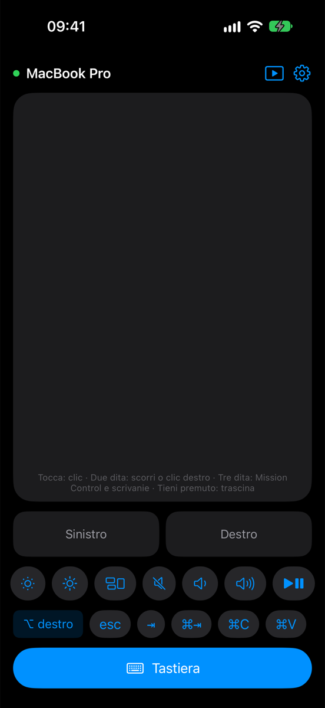
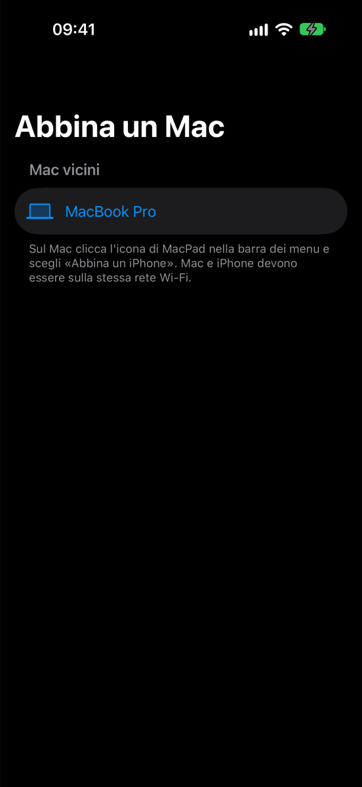
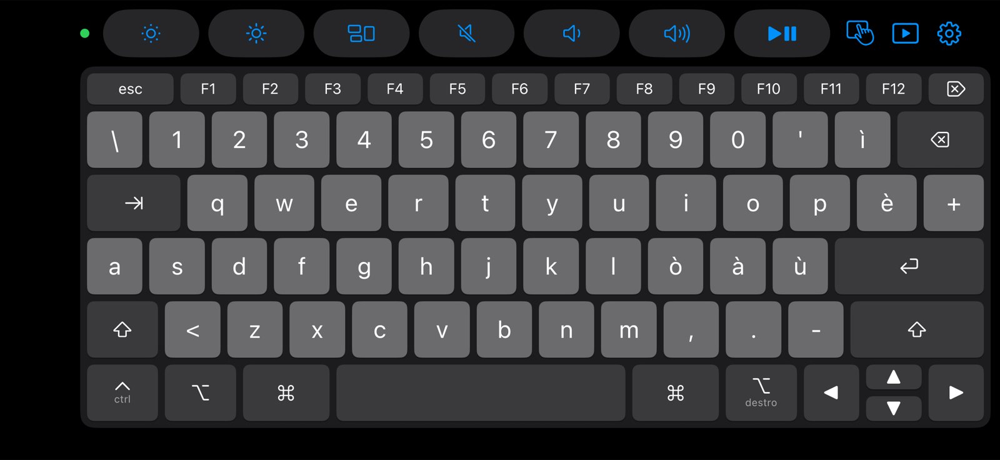

# MacPad

Turn your iPhone into a trackpad and keyboard for your Mac, over Wi‑Fi.

*[Italiano più sotto](#italiano)*

MacPad has two parts:
- **MacPad** – the iPhone app (iOS 18+)
- **MacPadHost** – a small menu‑bar app for the Mac (macOS 15+, Apple Silicon and Intel)

> The app interface is currently in Italian.

  
  &nbsp;&nbsp;
  

  

## Features
- Trackpad with click, scrolling (optional inertia) and three‑finger gestures (Mission Control, switch desktops)
- Keyboard, plus a full landscape keyboard that sends physical key codes (Italian – Pro layout labels)
- Media bar: volume, mute, play/pause, brightness
- Presentation mode with a laser pointer drawn on the Mac
- Type your Mac password with Face ID (only into secure password fields)
- Keeps the iPhone screen on while connected

## Security
- The two devices find each other with Bonjour on the local network. There is no server and no account.
- Pairing uses TLS‑PSK with a 6‑digit code shown on the Mac. The pairing window stays open for 2 minutes and closes after 5 wrong attempts.
- After pairing, every session is encrypted with a 256‑bit key, stored in the iPhone Keychain and in `~/Library/Application Support/MacPad/session.key` on the Mac. "Revoca tutti gli iPhone" (revoke all) generates a new key.
- The Mac password stays on the iPhone, in the Keychain, protected by Face ID. The Mac types it only when the focused field is a secure text field.

## Install

### Mac (MacPadHost)
1. Download `MacPadHost-x.y.zip` from [Releases](../../releases/latest) and unzip it. Move `MacPadHost.app` to Applications.
2. The app is **not notarized** by Apple, so macOS blocks it the first time. Open it, click "Done", then go to **System Settings › Privacy & Security** and click **Open Anyway**.
   Alternatively, in Terminal: `xattr -dr com.apple.quarantine /Applications/MacPadHost.app`
3. Grant **Accessibility** permission when asked (System Settings › Privacy & Security › Accessibility). MacPadHost needs it to move the pointer and type.
4. Allow **Local Network** access if macOS asks.

### iPhone (MacPad)
The iPhone app is not on the App Store. Use one of these options:

**Option A – Build with Xcode (free Apple ID)**
1. Clone this repo and open `MacPad.xcodeproj` in Xcode 16 or later.
2. Select the **MacPad** target › *Signing & Capabilities*: choose your own Team and change the Bundle Identifier (e.g. `com.yourname.macpad`), because a bundle ID can be registered by only one developer.
3. Connect your iPhone, enable **Developer Mode** (Settings › Privacy & Security) and press Run.
4. With a free Apple ID the app expires after **7 days**: run it again from Xcode to renew it. Your data is kept.

**Option B – Sideload the IPA**
Download `MacPad-x.y-unsigned.ipa` from [Releases](../../releases/latest) and install it with [AltStore](https://altstore.io) or [Sideloadly](https://sideloadly.io), which sign it with your Apple ID. The 7‑day limit still applies.

### First connection
1. Put the iPhone and the Mac on the same Wi‑Fi network.
2. On the Mac, click the MacPad icon in the menu bar and choose **"Abbina un iPhone…"** (pair an iPhone). A 6‑digit code appears.
3. Open MacPad on the iPhone, choose your Mac and enter the code.

## Tips
- **"Connessione diretta"** (direct connection) lets you use MacPad without a shared Wi‑Fi. Turn it on in both apps; the pointer may be less smooth.
- If the pointer stutters about once a second, AWDL (AirDrop "Everyone", Universal Control) is making the Mac's Wi‑Fi hop channels. Set AirDrop to "Contacts Only". The "Connessione diretta" (peer‑to‑peer) switch is off by default for the same reason.

## Building from source
- `iOS/` – iPhone app (SwiftUI, trackpad in UIKit)
- `Mac/` – menu‑bar host. It is not sandboxed and injects events with `CGEvent`.
- `Shared/` – protocol (one JSON line per `Message`) and the TLS‑PSK channel
- `Design/` – Swift scripts that draw the app icons
- Demo mode (Debug builds only), used for the screenshots: launch the iPhone app with `-demo` (connected to a fake Mac, add `-demoLandscape` for landscape) or `-demoPairing`.

## License
[MIT](LICENSE)

---

## Italiano

MacPad trasforma l'iPhone in trackpad e tastiera del Mac via Wi‑Fi. Ci sono due app: **MacPad** per iPhone (iOS 18+) e **MacPadHost** nella barra dei menu del Mac (macOS 15+).

**Mac:** scarica `MacPadHost-x.y.zip` da [Releases](../../releases/latest), spostalo in Applicazioni e aprilo. L'app non è notarizzata: al primo avvio vai in **Impostazioni di Sistema › Privacy e sicurezza › Apri comunque**. Poi concedi il permesso di **Accessibilità**.

**iPhone:** l'app non è sull'App Store. Hai due strade:
- apri il progetto in Xcode, scegli il tuo Team, cambia il Bundle Identifier e installa sul tuo iPhone con la modalità sviluppatore attiva;
- installa l'`.ipa` con AltStore o Sideloadly.

Con un Apple ID gratuito l'app scade dopo 7 giorni e va reinstallata.

**Primo collegamento:** iPhone e Mac sulla stessa rete Wi‑Fi. Sul Mac scegli «Abbina un iPhone…» dall'icona nella barra dei menu e inserisci sull'iPhone il codice di 6 cifre.
